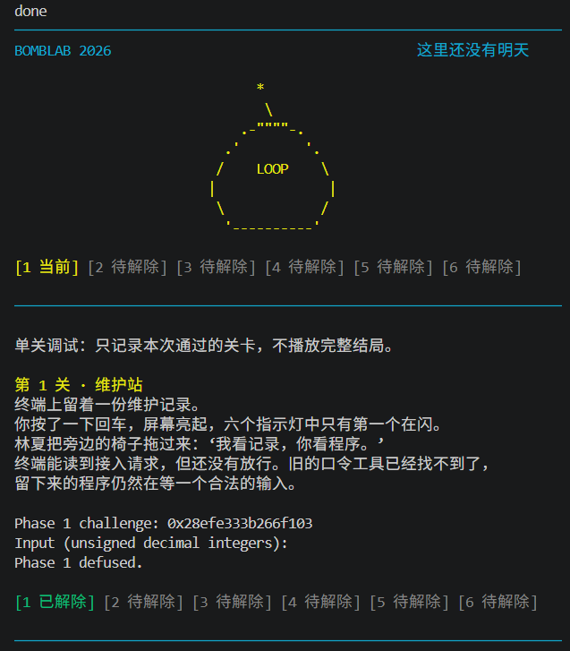
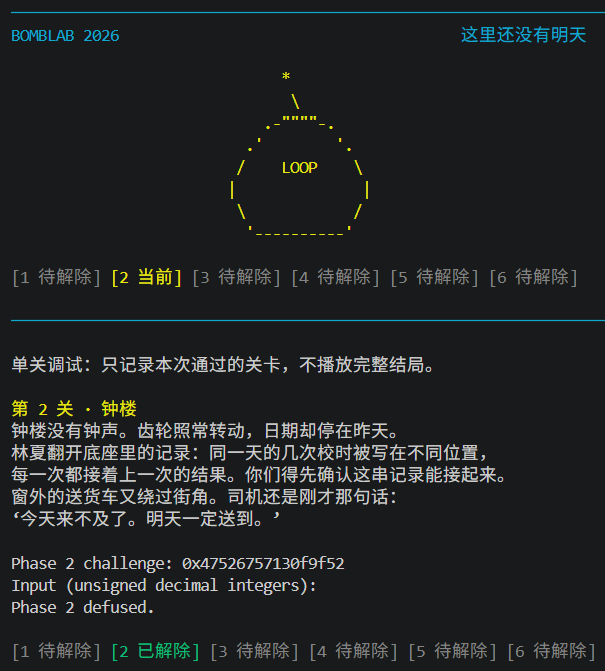
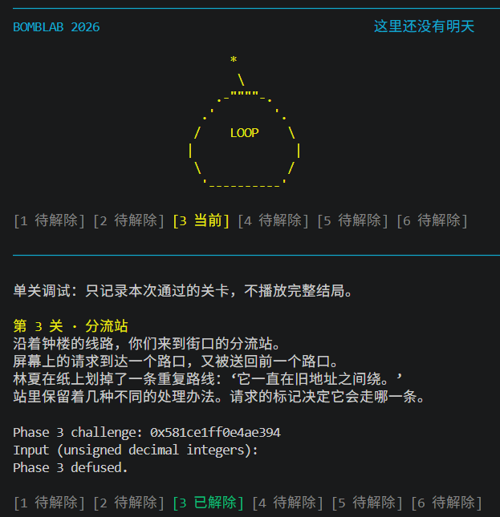
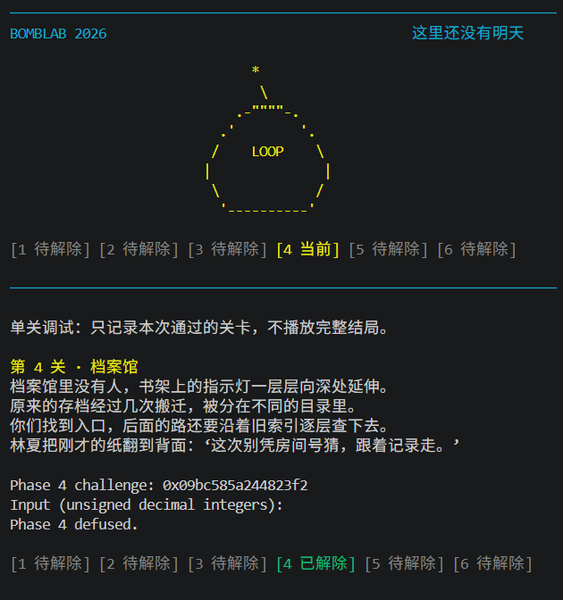
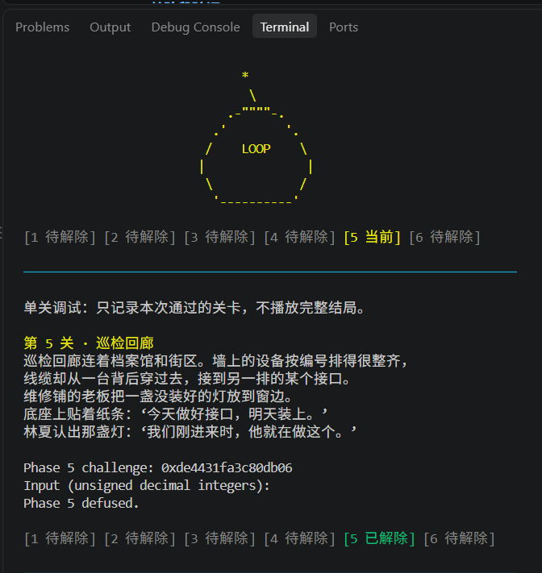
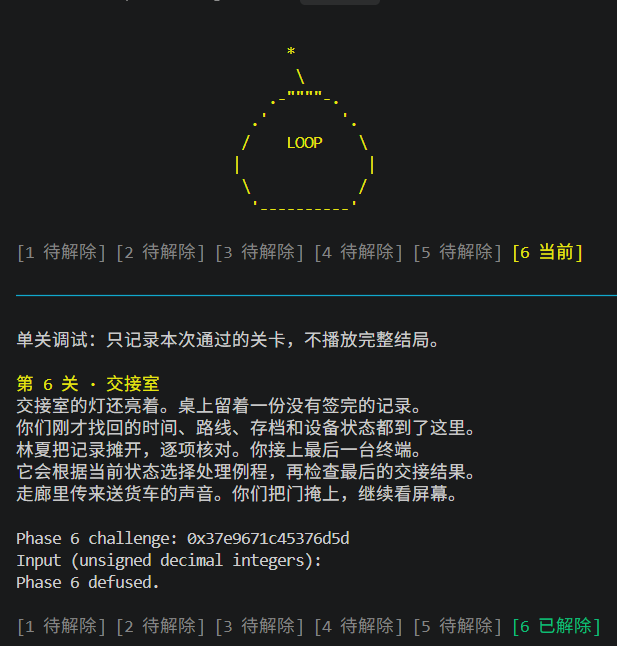
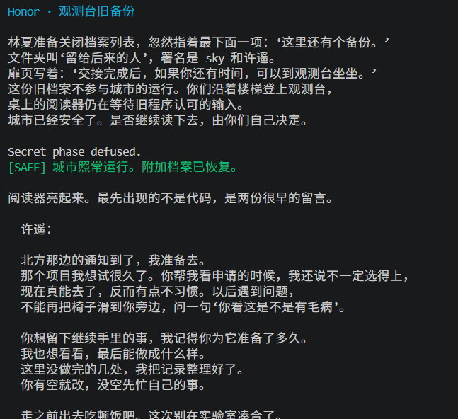
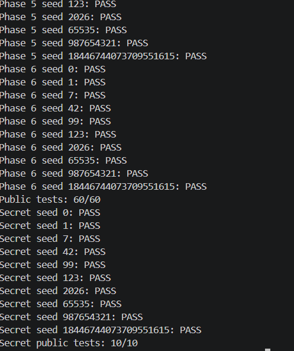

# Bomb Lab 实验报告

---

## 目录

1. [总方法论](#1-总方法论)
2. [通用知识点](#2-常用的错误点或者难点)
3. [Phase 1：调用链与 ABI](#3-phase-1调用链与-abi)
4. [Phase 2：循环与数组](#4-phase-2循环与数组)
5. [Phase 3：跳转表](#5-phase-3跳转表)
6. [Phase 4：递归](#6-phase-4递归)
7. [Phase 5：链表](#7-phase-5链表)
8. [Phase 6：函数指针与间接调用](#8-phase-6函数指针与间接调用)
9. [Honor：结构化校验与缓冲区偏移](#9-honor结构化校验与缓冲区偏移)
10. [验证结果](#10-验证结果)
11. [踩坑记录](#11-踩坑记录)
---


## 1. 总方法论

### 1.1 实验思路
整个实验的核心思路是**反向执行校验**：炸弹用 `cmp` / `jne` 检查答案，我们把每个比较条件翻译成等式，然后在 `defuser.c` 里**正向实现这些等式**。

```
一、定位校验点        cmp / jne / je / 跳转表 / 间接调用
二、翻译成等式        把寄存器运算还原为算术表达式，这里最好是反向跟踪一个特定的值。
三、在 C 里正向实现   先用伪代码表示，最后再组装起来。
四、组装输出格式     前面6个关卡输出格式统一，但honor的输出格式需要自己找出来
```
### 1.2 文档说明
汇报里面的文件是经过整理的，关于汇编文件的标注过程全部放在phase-0X.s文件中，其中phase--05.s的标注过程由于不小心覆写了所以缺失了。

## 2. 常用的错误点或者难点

| 陷阱 | 说明 |
|---|---|
| **32 位截断的位置** | 汇编里写 `%esi`/`%r8d` 会清零高 32 位，C 里对应的 `uint64_t` 表达式不会。必须显式 `(uint32_t)` 截断，且截断要发生在移位/加法之前 ，例如在honor关卡中我计算mid3的部分时候，由于64位数据位移后没有截断就再次进行位移，导致第32位出现了本来不应该出现的值导致defuser失败。|
| **`lea` 不访问内存** | `lea 0xf0e1(%rdi,%rdi,2),%eax` 等价于 `eax = 3*rdi + 0xf0e1`，不读内存 |
| **错误出口不设置 `%eax`** | 共享的错误出口往往只做 `add`/`pop`/`ret`，返回值是进入该标签时 `%eax` 的残留值 |
|**出现循环或者递归**|出现类似这种不好顺着往下推的结构的时候，不要直接暴力模拟，不然大脑容易栈溢出，根本写不出来，最好是把对应结构语义化，用伪代码的形式来表达。|


## 3. Phase 1：调用链与 ABI

### 3.1 定位

```bash
nm ./bomb | grep -E 'phase_01|p1_'
```

```
0000000000402090 T phase_01
0000000000402050 T p1_compute
0000000000402020 T p1_step0
0000000000402030 T p1_step1
0000000000402040 T p1_step2
```

`phase_01` 不自己做全部计算，而是**调用三个小函数**（`p1_step0/1/2`）。这类「计算被拆成多个 helper」的结构是阶段 1 的特征。

### 3.2 输入格式

`phase_01` 里 `mov $0x1,%esi` 与 `valid_u32_fields` 的组合表明**只需 1 个整数**。

### 3.3 关键观察

`%r12 = challenge`，然后：

```asm
call  p1_step1      ; 参与参数：bits32..63, bits16..47
call  p1_step0      ; 参与参数：bits0..31,  bits32..63
call  p1_step2
```

**注意这里出现了「challenge 的不同位段被分别送入不同 helper」的模式** —— 需要把 64 位 challenge 按 16 位或 32 位窗口切开分别处理。

### 3.4 实现

```c
int solve_phase_1(uint64_t challenge, char *out, size_t cap) {
    uint32_t values[MAX_FIELDS] = {0};
    size_t count = 1;
    uint32_t step_1 = ((challenge >> 16) + 0xaaa4) ^ (challenge >> 32);
    uint32_t step_2 = (3 * ((uint32_t)challenge - (challenge >> 32))) + 0x1ee5;
    values[0] = (uint32_t)((step_1 ^ 0x19a) + 8 * step_2);
    return write_answer(out, cap, values, count);
}
```

**验证**：

```bash
./defuser --seed 42 --phase 1        # 2936406603
./defuser --seed 42 --phase 1 | ./bomb --seed 42 --phase 1   # Phase 1 defused.
python3 public_test.py --phase 1     # 10/10
```

---

## 4. Phase 2：循环与数组

### 4.1 输入格式：6 个整数

```asm
mov  $0x6,%esi              ; valid_u32_fields 要求 6 个字段
sscanf(input, "%u %u %u %u %u %u",
       rdx = rbp-0x40,  rcx = rbp-0x3c,  r8 = rbp-0x38,
       r9  = rbp-0x34,  [栈] rbp-0x30,   [栈] rbp-0x2c)
```

**格式串地址 `0x40317a`**，实际内容为 `"%u %u %u %u %u %u"`。

**这是本关第一个知识点**：参数超过 6 个时，第 7 个起走栈 —— 这里虽然只有 6 个字段，但 `sscanf` 的 `%u` 目标里有 2 个被放到了栈上，说明编译器把 6 个目标分配为 4 寄存器 + 2 栈。

### 4.2 第一个检查（`0x40215a` – `0x40216c`）

推出：

```
values[0] == 3 * ((challenge >> 24) & 0x7f)
```

### 4.3 循环（`0x40216e` – `0x40219b`）

```asm
40216e: mov  $0x0,%edx          ; 循环变量（字节偏移）
...
402181: lea  (%rsi,%rsi,4),%ecx ; ecx = rsi*5   ★ 在 rsi 重载之前算
402184: mov  ...(%r15),%esi     ; 重载 rsi（下一个 nibble）
...
40219b: cmp  $0x14,%edx         ; 0x14 = 20，退出
```

**两个关键点**：

1. **循环变量以字节偏移走**：`%edx` 取 `0, 4, 8, 12, 16`，对应下标 `i = 0..4`
2. **`lea (%rsi,%rsi,4),%ecx` 必须在下一次重载 `%rsi` 之前执行** —— 它用的是**上一轮的 `%rsi`**，即 `values[i]` 的值

**移位量**：`%cl = rdx + 15`，即 `15 + 4i`。

**nibble**：`(challenge >> (15 + 4i)) & 0xf`

**循环体**：

```
values[i+1] = 5 * values[i] + (nibble ^ (3 + i))
```

### 4.4 实现

```c
int solve_phase_2(uint64_t challenge, char *out, size_t cap) {
    uint32_t values[MAX_FIELDS] = {0};
    size_t count = 6;
    values[0] = 3 * ((uint32_t)(challenge >> 24) & 0x7f);

    for (uint32_t i = 0; i < 5; i = i + 1) {
        uint32_t nibble = (uint32_t)((challenge >> (0xf + 4 * i)) & 0xf);
        values[i + 1] = 5 * values[i] + (nibble ^ (0x3 + i));
    }
    return write_answer(out, cap, values, count);
}
```

**注意**：`(uint32_t)challenge >> shift` 会**先截断再移位**，导致高位的 nibble 丢掉；正确写法是 `(uint32_t)(challenge >> shift)` —— **先移位，后截断**。判断依据是汇编里 `shr` 在 `and` 之前。

---

## 5. Phase 3：跳转表

### 5.1 输入格式：2 个整数

```asm
call valid_u32_fields(+, 2)
sscanf(input, "%u %u", rbp-0x18, rbp-0x14)
```

格式串 `0x403186` 内容为 `"%u %u"`。

### 5.2 第一个字段：索引

```
values[0] = challenge & 0x7
```

### 5.3 分派参数

```asm
mov   %eax = challenge >> 3
mov   %esi = challenge >> 32
xor   %eax,%esi
call  p3_dispatch
```

**注意**：`%eax = challenge >> 3`（64 位移位后取低 32 位），`%esi = challenge >> 32`。

```
dispatch 参数 x = (uint32_t)(challenge >> 32) ^ (uint32_t)(challenge >> 3)
```

### 5.4 跳转表

```asm
402250: mov  %edi,%eax
        mov  %esi,%edi
        cmp  $0x7,%eax
        ja   4022a5              ; > 7 则返回 0
        notrack jmp *0x405820(,%rax,8)
```
根据`cmp  $0x7,%eax`可以发现至多只有8个选项所及等价捕捉跳转表的时候
也可以只捕捉8个

```bash
objdump -s -j .rodata ./bomb | grep -A2 '405820'
```

得到 8 个 8 字节表项：

| 索引 | 表项 | 跳转目标 |
|---|---|---|
| 0 | `0x402278` | `0x402230` |
| 1 | `0x402280` | `0x402210` |
| 2 | `0x402288` | `0x402240` |
| 3 | `0x402290` | `0x402200` |
| 4 | `0x402298` | `0x402220` |
| 5 | `0x4022a0` | `0x4021d0` |
| 6 | `0x402268` | `0x4021b0` |
| 7 | `0x402270` | `0x4021f0` |


### 5.5 索引 → 公式映射

读取每个 case 函数的指令后得到：

| 索引 | 函数 | 公式 |
|---|---|---|
| 0 | `p3_case_6` | `5x + 0xbe95` |
| 1 | `p3_case_4` | `5x + 0x365ce` |
| 2 | `p3_case_7` | `2x ^ 0x6621` |
| 3 | `p3_case_3` | `3x + 0x1d1` |
| 4 | `p3_case_5` | `(x ^ 0xb3c) + (x >> 1)` |
| 5 | `p3_case_1` | `(x ^ 0x8eca) + (x >> 2)` |
| 6 | `p3_case_0` | `4x ^ 0xdf2b` |
| 7 | `p3_case_2` | `5x + 0x33d0b` |


### 5.6 实现

```c
int solve_phase_3(uint64_t challenge, char *out, size_t cap) {
    uint32_t values[MAX_FIELDS] = {0};
    size_t count = 2;
    values[0] = (uint32_t)challenge & 0x7;
    uint32_t rdi = (uint32_t)challenge & 0x7;
    uint32_t rsi = (uint32_t)((challenge >> 0x20) ^ (challenge >> 0x3));
    switch (rdi) {
    case 0: values[1] = 5 * rsi + 0xbe95;               break;
    case 1: values[1] = 5 * rsi + 0x365ce;              break;
    case 2: values[1] = (2 * rsi) ^ 0x6621;             break;
    case 3: values[1] = 3 * rsi + 0x1d1;                break;
    case 4: values[1] = (rsi ^ 0xb3c) + (rsi >> 1);     break;
    case 5: values[1] = (rsi >> 0x2) + (rsi ^ 0x8eca);  break;
    case 6: values[1] = (4 * rsi) ^ 0xdf2b;             break;
    case 7: values[1] = 5 * rsi + 0x33d0b;              break;
    }
    return write_answer(out, cap, values, count);
}
```


---

## 6. Phase 4：递归

### 6.1 输入格式：1 个整数

### 6.2 递归结构

`phase_04` 调用一个递归 helper。整理后：

```
p4_walker(a, b, c, d):
    mid = ((c - b) >> 1) + b            # 二分中点
    if mid == a:   return (mid + 163) ^ d
    if a < mid:    res = p4_walker(a, b, mid-1, d)
                   return (5*res) ^ (mid + d) ^ 0x1d
    else:          res = p4_walker(a, mid+1, c, d)
                   return (5*res) ^ (mid + d) ^ 0x5
```

**特征**：

| 特征 | 说明 |
|---|---|
| `mid = low + (high - low)/2` | 标准二分查找中点 |
| 三个分支 | `==` 基例、`<` 递归左半、`>` 递归右半 |
| **基例返回 `(mid + 163) ^ d`** | `163` 是魔数，应确认是十进制 |
| 两个递归分支用**不同的异或常量** | `0x1d` 与 `0x5`，不能混淆 |
| 返回值上有 `5*res` | **每层递归都要做一次乘 5 再异或**，累计起来影响很大 |

**注意**：一开始写这个题目的时候由于没有语义化地来看汇编文件，前面几个phase都是暴力从上往下看全看出来，这个题目就完全看不下去，后面语义化处理才得到解决。

### 6.3 实现

```c
int p4_walker(uint32_t a, uint32_t b, uint32_t c, uint32_t d) {
    uint32_t mid = ((c - b) >> 1) + b;
    uint32_t res;
    if (mid == a) {
        return (mid + 163) ^ d;
    } else if (a < mid) {
        res = p4_walker(a, b, mid - 1, d);
        return (5 * res) ^ (mid + d) ^ 0x1d;
    } else {
        res = p4_walker(a, mid + 1, c, d);
        return (5 * res) ^ (mid + d) ^ 0x5;
    }
}

int solve_phase_4(uint64_t challenge, char *out, size_t cap) {
    uint32_t values[MAX_FIELDS] = {0};
    size_t count = 1;
    uint32_t b = (uint32_t)challenge;
    values[0] = p4_walker(b & 0x7f, 0, 127,
                          (uint32_t)((challenge >> 7) ^ (challenge >> 0x20)));
    return write_answer(out, cap, values, count);
}
```

---

## 7. Phase 5：链表

**本关的难点不在算法，而在于：链表数据只存在于 `bomb` 的 `.rodata` 里，`defuser` 里没有。**

### 7.1 数据在哪

```bash
nm ./bomb | grep -i p5
```

```
0000000000405b60 r p5_heads
0000000000405ba0 r p5_nodes
0000000000402420 T p5_traverse
```

```bash
nm ./defuser | grep -i p5      # 空！
```

**注意**：`defuser` 是独立程序，它 **没有** `p5_nodes`。所以不能引用炸弹的地址，必须**把数据搬进自己的源码**，两者的内存地址并不公用，必须把链表里面的死数据可给爬出来整理。

### 7.2 节点结构

```asm
402456: add  (%rdx),%eax        ; 字段 @ +0
402449: mov  0x4(%rdx),%esi     ; 字段 @ +4
402467: mov  0x8(%rdx),%rdx     ; next  @ +8
```

```c
struct node {
    uint32_t val0;   /* +0 */
    uint32_t val1;   /* +4 */
    uint64_t next;   /* +8 */
};                   /* 共 16 字节 */
```

### 7.3 节点个数 = 12（两条独立证据）

**证据 A：符号边界**

```
p5_nodes 起始 = 0x405ba0
下一个符号 secret_agent_urgent = 0x405c60
0x405c60 - 0x405ba0 = 0xC0 = 192 字节
192 / 16 = 12 个节点
```

**证据 B：遍历到 NULL**

用 gdb 从 `head[0]` 起沿 `next` 走，**恰好 12 步后遇到 NULL**。

两条证据互相印证。

### 7.4 完整链表（按 `next` 顺序）

| # | 地址 | val0 | val1 | next |
|---|---|---|---|---|
| 0 | 0x405ba0 | 53352 | 1033 | 1 |
| 1 | 0x405c10 | 43702 | 21 | 2 |
| 2 | 0x405c00 | 25500 | 1644 | 3 |
| 3 | 0x405c30 | 12916 | 1895 | 4 |
| 4 | 0x405c20 | 146 | 1293 | 5 |
| 5 | 0x405bb0 | 64803 | 622 | 6 |
| 6 | 0x405bd0 | 1949 | 2673 | 7 |
| 7 | 0x405bf0 | 34225 | 304 | 8 |
| 8 | 0x405bc0 | 38201 | 2100 | 9 |
| 9 | 0x405c40 | 21166 | 2394 | 10 |
| 10 | 0x405be0 | 44104 | 2917 | 11 |
| 11 | 0x405c50 | 9027 | 882 | NULL |

### 7.5 算法（`p5_traverse`）

```
cur  = head[challenge & 7]
con1 = ((challenge >> 6) ^ (challenge >> 32)) ^ 0xe340
acc  = (3 * con1 + node[cur].val0) ^ node[cur].val1
v    = node[cur].val1
cond = (uint32_t)((challenge >> 3) & 0x3)

if cond == 0:
    return {acc, v}                      /* ★ 提前返回，不进入循环 */

for i in 1..cond:
    cur = node[cur].next
    acc = 3 * acc                        /* 先乘 3 */
    v   = node[cur].val1
    acc = node[cur].val0 + acc           /* 再加 val0 */
    acc = acc ^ v                        /* 最后异或 val1 */

return {acc, v}
```

**⚠️ 四个必须注意的点**：

1. **循环次数是 `cond` 次**，`cond` 表示「总共访问 `cond` 个节点」
2. **`cond == 0` 必须提前返回** —— 否则后续代码会用未初始化的 `v` 覆盖
3. **`acc` 每轮先乘 3**（`lea (%rax,%rax,2),%eax`），**再加 `val0`，最后异或 `val1`** —— 顺序不能换
4. **必须用下标而非指针** —— `defuser` 里没有炸弹的 `.rodata`，硬编码地址会段错误

### 7.6 实现

```c
int solve_phase_5(uint64_t challenge, char *out, size_t cap) {
    typedef struct {
        uint32_t val0;
        uint32_t val1;
        int32_t  next;      /* ★ 用下标代替指针 */
    } p5_node;

    static const p5_node p5_nodes[12] = {
        { 53352, 1033,  1 }, { 43702,   21,  2 }, { 25500, 1644,  3 },
        { 12916, 1895,  4 }, {   146, 1293,  5 }, { 64803,  622,  6 },
        {  1949, 2673,  7 }, { 34225,  304,  8 }, { 38201, 2100,  9 },
        { 21166, 2394, 10 }, { 44104, 2917, 11 }, {  9027,  882, -1 },
    };
    static const int32_t p5_heads[8] = { 0, 1, 2, 3, 4, 5, 6, 7 };

    uint32_t values[MAX_FIELDS] = {0};
    size_t count = 2;
    int32_t cur = p5_heads[challenge & 0x7];

    uint32_t con1 = (uint32_t)(((challenge >> 0x6) ^ (challenge >> 0x20)) ^ 0xe340);
    uint32_t rax = (3 * con1 + p5_nodes[cur].val0) ^ p5_nodes[cur].val1;
    uint32_t rsi = p5_nodes[cur].val1;

    if (((challenge >> 0x3) & 0x3) == 0) {
        values[0] = rax;
        values[1] = p5_nodes[cur].val1;
        return write_answer(out, cap, values, count);
    }

    int i = 1;
    while ((uint64_t)((challenge >> 0x3) & 0x3) >= (uint64_t)i) {
        cur = p5_nodes[cur].next;
        rax = 3 * rax;
        i++;
        rsi = p5_nodes[cur].val1;
        rax = p5_nodes[cur].val0 + rax;
        rax = rax ^ rsi;
    }
    values[0] = rax;
    values[1] = rsi;
    return write_answer(out, cap, values, count);
}
```

---

## 8. Phase 6：函数指针与间接调用

### 8.1 结构

阶段 6 的模式与阶段 3 的跳转表类似，但用的是**函数指针表 + 间接 `call`**：

```asm
call  *表(,%r?,8)
```

**与阶段 3 的区别**：

| | Phase 3 | Phase 6 |
|---|---|---|
| 分派方式 | `jmp *表(,%rax,8)` | `call *表(,%r?,8)` |
| 表项内容 | 代码标签地址 | **函数地址** |
| 栈行为 | 不压返回地址 | **压返回地址，call 后有返回点** |

### 8.2 变换表

读取函数指针表得到 6 个变换：

| 索引 | 变换 |
|---|---|
| 1 | `rotr32(a, 3)` |
| 4 | `rol32(a, 1) ^ 0x9e38` |
| 5 | `(a << 7) + (a ^ 0x6236)` |
| 0 | `((a << 5) + 0xa0e1) ^ (5 * a)` |
| 2 | `((a >> 5) ^ a) + 0x32aa` |
| 3 | `(a + 0x5b00) ^ (a >> 7)` |

**⚠️ 只有 6 个变换，但索引范围是 0~7** —— 需要通过一个映射数组 `way[8]` 把 8 个索引映射到 6 个变换。

### 8.3 循环移位辅助函数

```c
uint32_t rotr32(uint32_t x, unsigned int n) {
    n %= 32;
    return (x >> n) | (x << ((32 - n) % 32));
}

uint32_t rol32(uint32_t x, unsigned int n) {
    n %= 32;
    return (x << n) | (x >> ((32 - n) % 32));
}
```


### 8.4 实现

```c
uint32_t p6_switch(uint32_t a, uint32_t choice) {
    int way[8] = {1, 4, 5, 0, 2, 4, 3, 2};
    int tmp = way[choice];

    switch (tmp) {
    case 1: a = rotr32(a, 3);                       break;
    case 4: a = rol32(a, 1); a = a ^ 0x9e38;        break;
    case 5: a = (a << 7) + (a ^ 0x6236);            break;
    case 0: a = ((a << 5) + 0xa0e1) ^ (5 * a);      break;
    case 2: a = ((a >> 5) ^ a) + 0x32aa;            break;
    case 3: a = (a + 0x5b00) ^ (a >> 7);            break;
    }
    return a;
}

int solve_phase_6(uint64_t challenge, char *out, size_t cap) {
    uint32_t values[MAX_FIELDS] = {0};
    size_t count = 1;
    uint32_t tmp;
    tmp = p6_switch((uint32_t)((challenge >> 6) ^ (challenge >> 32)),
                    (uint32_t)(challenge & 7));
    tmp = p6_switch(tmp ^ 0x3ab, (challenge >> 3) & 7);
    values[0] = tmp + 0xf400;
    return write_answer(out, cap, values, count);
}
```
---

## 9. Honor：结构化校验与缓冲区偏移

Honor 与前六关的**本质区别**：前六关输出几个整数，Honor 要输出**一整行满足多重约束的文本**。

### 9.1 调用链

```
secret_gate(输入行, challenge, context)
    ├─ ① 长度检查 36 ≤ strlen ≤ 163
    ├─ ② secret_copy(line → 栈缓冲区)
    ├─ ③ 检查缓冲区偏移 32 处 == "OPEN"
    └─ ④ secret_phase(line + 36, challenge, context)
           ├─ 校验 1: a == context & 3
           ├─ 校验 2: b == ...
           └─ 校验 3: c == ...
```

对应的函数地址：

| 函数 | 地址 |
|---|---|
| `secret_phase` | `0x402650` |
| `secret_gate` | `0x402730` |
| `secret_copy` | `0x402710` |
| `secret_mix` | `0x402630` |

### 9.2 `secret_copy`：手写 `strcpy`

```asm
402714: xor    %eax,%eax
402720: movzbl (%rsi,%rax,1),%edx     ; 读 1 字节，零扩展到 32 位
402724: mov    %dl,(%rdi,%rax,1)      ; 写 1 字节
402727: add    $0x1,%rax
40272b: test   %dl,%dl
40272d: jne    402720
```

**`movzbl`**：`mov` + `z`（zero-extend）+ `b`（byte）—— 读 1 字节、高位补零。

**结构是 do-while**（先复制后判断），保证 `'\0'` 也被复制。等价于：

```c
void secret_copy(char *dst, const char *src) {
    size_t n = 0;
    do { dst[n] = src[n]; } while (src[n++] != '\0');
}
```

### 10.3 `secret_gate`：长度与偏移

**① 长度检查**

```asm
40276c: call   strlen@plt
402771: sub    $0x24,%rax      ; rax = len - 36
402775: cmp    $0x7f,%rax
402779: jbe    402790          ; 无符号比较
```

**`jbe` 是无符号比较**，所以 `len < 36` 时 `len - 36` 回绕成极大值 → 被拒。

```
36 ≤ len ≤ 163
```

**② 偏移的来源（本关最关键的发现）**

```asm
40274b: lea    -0xd0(%rbp),%r12          ; 复制目标起点
402796: call   secret_copy               ; secret_copy(rbp-0xd0, 输入行)
40279b: cmpl   $0x4e45504f,-0xb0(%rbp)   ; 但检查这里！
```

**做减法**：

```
(-0xb0) - (-0xd0) = 0x20 = 32
```

**→ `"OPEN"` 必须在**输入的第 32 个字节**，不是开头！**


```
输入 = "OPEN 3 4287074565 3883948054"（长度 38 ≥ 36）
→ buffer = "OPEN 3 ..."
→ M[rbp-0xb0] = 0x20202020（4 个空格）≠ 0x4e45504f
→ 失败（BOOM）

输入 = 32 空格 + "OPEN 3 4287074565 3883948054"
→ M[rbp-0xb0] = 0x4e45504f ✓
→ 通过（Secret phase defused.）
```

**`0x4e45504f` 的含义**（小端）：

```
0x4e45504f → 4f 50 45 4e → 'O' 'P' 'E' 'N'
```

**③ 三个数的位置**

```asm
4027ad: lea    -0xac(%rbp),%rdi     ; 传给 secret_phase
4027b4: call   secret_phase
```

`rbp-0xac = rbp-0xb0 + 4` —— 正好是 `"OPEN"` 之后。

**→ 三个偏移串起来就是答案的形状**：

```
rbp-0xd0  ┌──────────────────────┐
          │  32 字节（内容任意）   │   ← 无检查
rbp-0xb0  ├──────────────────────┤
          │  'O' 'P' 'E' 'N'     │   ← cmpl 检查
rbp-0xac  ├──────────────────────┤
          │  " a b c"            │   ← sscanf 解析
          └──────────────────────┘
```

**这也解释了长度下限 36 = 32 + 4** —— 与 `sub $0x24` 完美吻合，是两个独立数字的互相印证。

### 9.4 `secret_phase`：三个公式

**格式串**（地址 `0x403183`）：

```asm
40269a: mov    $0x403183,%esi
```

```bash
objdump -s -j .rodata ./bomb | grep -A2 '403180'
# 403180: 25 75 20 25 75 20 25 75 20 25 75 00
#         %  u ␣  %  u ␣  %  u ␣  %  u \0
```

```
0x403183: 0x25 0x75 0x20 0x25 0x75 0x20 0x25 0x75
          '%'  'u'  ' '  '%'  'u'  ' '  '%'  'u'
```

**`0x20` 就是分隔符（空格）。**


**三条校验**（`cmp A,B` 表示 `B - A`，相等即通过）：

**校验 1**（`0x4026b8`）

```asm
4026b0: mov    %r13d,%ecx
4026b5: and    $0x3,%ecx
4026b8: cmp    %ecx,-0x2c(%rbp)
```

```
a = context & 3
```

**校验 2**（`0x4026ec`）

```asm
4026bd: mov    %r12,%rsi
4026ca: shr    $0x20,%rsi
4026d2: xor    %r12d,%esi        ; rsi = (b>>32) ^ (uint32)b
4026c7: mov    %r13,%r8
4026ce: shr    $0x20,%r8
4026d5: xor    %r13d,%r8d        ; r8 = (c>>32) ^ (uint32)c
4026c0: imul   $0xf0e1,%ecx,%r9d ; r9 = (c&3) * 0xf0e1
4026d8: shr    $0x10,%r13
4026de: xor    %r13d,%r9d        ; r9 ^= (c>>16)
4026dc: mov    %esi,%edi
4026e1: xor    %r8d,%edi         ; secret_mix 入参
4026e4: call   secret_mix
4026e9: xor    %r9d,%eax
```

配合 `secret_mix`：

```asm
402634: lea    0xf0e1(%rdi,%rdi,2),%eax   ; 3x + 0xf0e1
40263b: xor    $0x1a65,%eax
```

```
mC  = (uint32_t)((challenge >> 32) ^ challenge)
mX  = (uint32_t)((context   >> 32) ^ context)
mix = (3 * (mC ^ mX) + 0xf0e1) ^ 0x1a65
r9  = ((context & 3) * 0xf0e1) ^ (uint32_t)(context >> 16)
b   = mix ^ r9
```

**校验 3**（`0x4026ff`）

```asm
4026f1: shr    $1,%esi
4026f3: lea    0x1a65(%r8,%rcx,1),%edx    ; r8 + (c&3) + 0x1a65
4026fb: add    %esi,%edx
4026fd: xor    %edx,%eax                   ; eax 此时是 b
4026ff: cmp    -0x24(%rbp),%eax
```

```
c = b ^ (mX + (context & 3) + 0x1a65 + (mC >> 1))
```


### 10.5 长度计算

```
32（填充）+ 4（"OPEN"）+ 1（空格）+ len(a) + 1 + len(b) + 1 + len(c)
= 39 + len(a) + len(b) + len(c)
```

| 情况 | 长度 |
|---|---|
| `a=b=c=0` | 42 |
| 三个都是 10 位数 | 69 |

**→ 永远落在 `36 ~ 163` 内，长度约束自动满足。**

### 9.6 实现

```c
int solve_secret(uint64_t challenge, uint64_t context, char *out, size_t cap) {
    uint64_t b = challenge;
    uint64_t c = context;

    /* ★ 先截断到 32 位，对应汇编里的 xor %esi / xor %r8d */
    uint32_t bc = (uint32_t)((b >> 0x20) ^ b);
    uint32_t cc = (uint32_t)((c >> 0x20) ^ c);

    uint32_t mid  = bc ^ cc;
    uint32_t mid2 = (uint32_t)((3u * mid + 0xf0e1u) ^ 0x1a65u)
                  ^ (uint32_t)(((uint32_t)(c & 0x3u) * 0xf0e1u)
                               ^ (uint32_t)(c >> 0x10));
    uint32_t mid3 = cc + (uint32_t)(c & 0x3u) + 0x1a65u + (bc >> 1);

    uint32_t first  = (uint32_t)(c & 0x3u);
    uint32_t second = mid2;
    uint32_t third  = mid2 ^ mid3;

    int n = snprintf(out, cap, "%32sOPEN %u %u %u", "", first, second, third);
    if (n < 0 || (size_t)n >= cap) return 1;

    return 0;    /* ★ 成功必须返回 0 */
}
```


---

## 10. 验证结果

### 10.1 编译

```bash
make clean && make
```

**因 `-Werror`，任何警告都会导致编译失败。**

### 10.2 全部阶段验证

```bash
{ ./defuser --seed 42; ./defuser --secret --seed 42; } | ./bomb --seed 42
```








### 10.3 公开测试

```bash
python3 public_test.py
```

覆盖的 10 个公开 seed：

```
0, 1, 7, 42, 99, 123, 2026, 65535, 987654321, 18446744073709551615
```



---

## 11. 踩坑记录

### 11.1 阶段 2：截断顺序搞反

**现象**：seed 42 得到 `186352`，期望 `186354`（最后一位差 2）。

**原因**：

```c
(uint32_t)challenge >> shift        /* 错：先截断到 32 位，再移位 → 高位 nibble 丢失 */
(uint32_t)(challenge >> shift)      /* 对：先 64 位移位，再截断 */
```

**判断依据**：汇编是 `shr` 在前、`and` 在后，所以 C 里 `>>` 必须在 `(uint32_t)` 之前。

**规则**：**C 里的强制类型转换只作用于一个操作数，必须通过比对汇编的操作顺序来决定括号位置。**

### 11.2 阶段 3：`case 7` 用错变量

**现象**：seed 99 / 123 失败（`wrong_answer`）。

**原因**：`case 7` 写成了 `5 * rdi + 0x33d0b`，但 `rdi` 是索引（0~7），公式里的 `x` 应该是分派参数 `rsi`。

**修正**：`values[1] = 5 * rsi + 0x33d0b;`

**教训**：**索引和分派参数是两个不同的量，容易在 `switch` 里混用。**

### 11.3 阶段 5：硬编码炸弹地址导致段错误

**现象**：`./defuser --seed 42 --phase 5` → `Segmentation fault`。

**原因**：代码里直接引用了炸弹的地址 `0x405b60`。但 `defuser` 是独立程序：

```bash
gdb -ex 'x/8gx 0x405b60' ./defuser
# Cannot access memory at address 0x405b60
```

**`defuser` 的内存布局只到约 `0x5020`**（`.rodata` @ `0x3000`，`.data` @ `0x5000`），根本没有 `0x405b60` 这段。

**修正**：把链表数据以**数组 + 下标**的形式搬进 `defuser.c`。

**教训**：**`nm ./defuser | grep p5` 为空就是最直接的证据 —— 数据不在这个程序里。**

### 11.4 阶段 5：缺少 `cond == 0` 的提前返回

**现象**：部分 seed 结果错误。

**原因**：`while` 无条件执行，导致 `cond == 0` 时用未初始化的值覆盖了正确结果。

**修正**：在 `if (cond == 0)` 分支里直接 `return`，等价于汇编的 `je 40247f`。

### 11.5 Honor：误以为 `"OPEN"` 在开头

**现象**：输入 `"OPEN 3 4287074565 3883948054"`（长度 38，满足长度要求）仍然 BOOM。

**原因**：`"OPEN"` 必须在**偏移 32** 处，不是开头。

**修正**：前面补 32 字节填充。

**诊断过程**（值得记录）：在 `0x40279b` 处观察内存：

```
输入 = "OPEN 3 4287074565 3883948054"
M[rbp-0xb0] = 0x20202020（空格）≠ 0x4e45504f  → 失败

输入 = 32 空格 + "OPEN 3 4287074565 3883948054"
M[rbp-0xb0] = 0x4e45504f  → 通过
```

**教训**：**当两个内存地址参与同一个判断时，一定要做减法求偏移。**

### 11.6 Honor：忘记把 `return 1` 改成 `return 0`

**现象**：测试全部显示 `not attempted`。

**原因**：模板默认 `return 1` 表示「未实现」，即使 `out` 写对了也不算数。

**教训**：**返回值是协议的一部分，不是可选项。**

### 11.7 `-Werror=parentheses` 的括号问题

**现象**：编译失败。

**原因**：`^` 与 `+` 混用时，编译器要求显式括号。

**修正**：`(3 * x + 0xf0e1) ^ 0x1a65` 这样加括号。

**规律**：**`^` 的优先级低于 `+`/`-` 但高于 `&`/`|`。混用时全部加括号。**

### 11.8 Honor：32 位截断发生在加法之后

**现象**：seed 0/42/99/123 通过，seed 1/7/2026/65535/987654321 失败。

**原因**：

```c
(((b >> 0x20) ^ b) >> 1)           /* 错：64 位 XOR 后做 64 位移位，
                                        第 32 位会右移到第 31 位参与结果 */
((uint32_t)((b >> 0x20) ^ b) >> 1) /* 对：先截断到 32 位再移位，
                                        等价于汇编的 xor %r12d,%esi; shr $1,%esi */
```

**诊断依据**：汇编里 `xor %r12d,%esi` 写的是 **32 位**寄存器 `%esi`，硬件会自动清零 `%rsi` 的高 32 位；而 C 里 `(b >> 0x20) ^ b` 是 `uint64_t` 运算，高位**保留**。

**教训（本实验最重要的一条）**：

> **汇编里任何写 `%esi` / `%r8d` / `%ecx` 的地方，都会把 64 位寄存器的高 32 位清零。C 里对应的 `uint64_t` 表达式不会。必须显式 `(uint32_t)` 截断，且截断要发生在移位/加法之前。**

**判断方法**：看汇编里目标寄存器是 `e`xx 还是 `r`xx，决定 C 里在哪里插 `(uint32_t)`。
